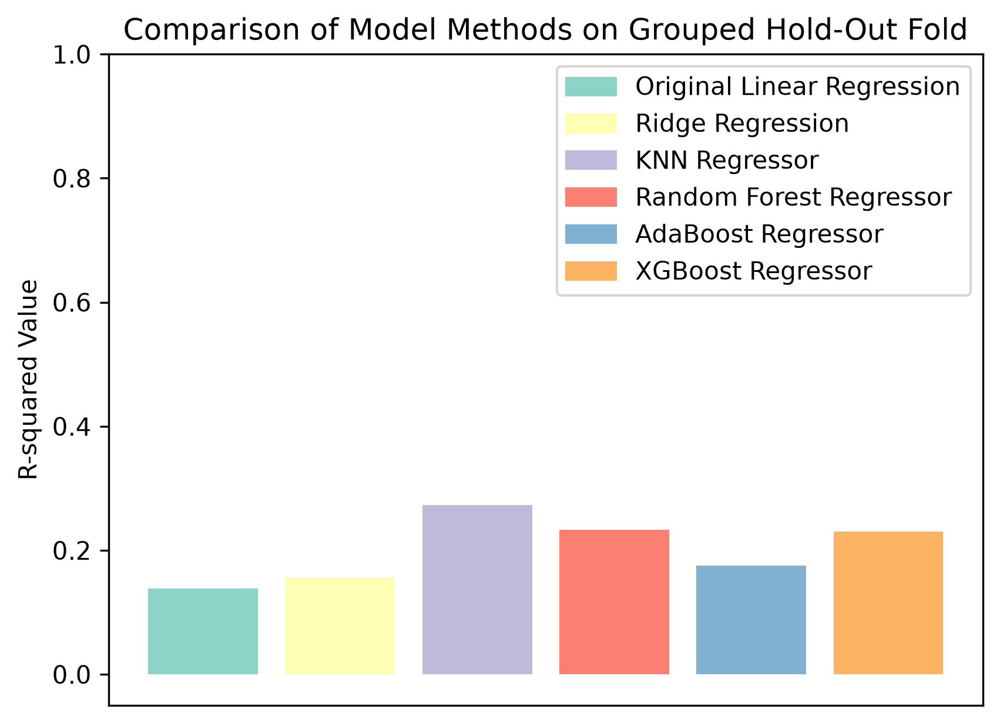
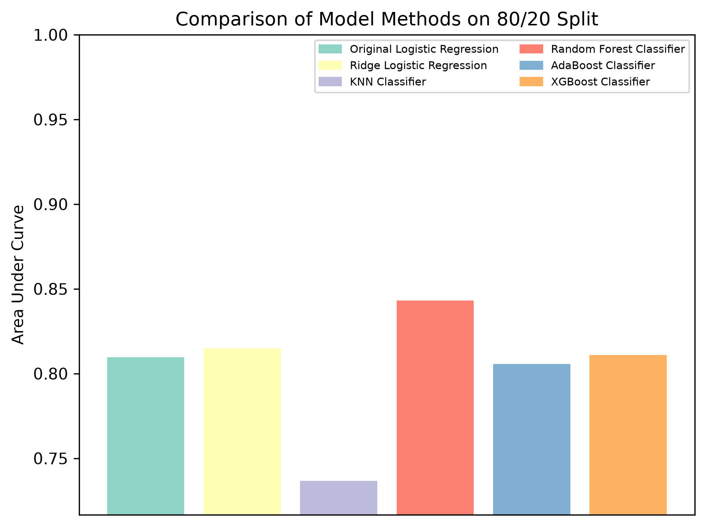

# Legged Robot Regression Analysis

Currently, legged robots often struggle the most with remaining balanced in unpredictable real-world environments. This study builds upon the new advancements in custom odometry for the Unitree Go1 robot that has been developed to combat the unreliable sensor data that can impact a legged robot’s stability. This project is in-progress and will be continuously updated.

## Methodology

Particularly, machine learning models for zero-moment point were used to try to represent and predict instability based on the robot's velocity, roll, pitch, and the environment the robot was in, using the recorded data from Ou’s improved robot.

Due to the limitations in the linear regression techniques, several machine learning models were introduced.

### Quantitative Results

K-Nearest Neighbors (KNN) attained a multiple R2 value of approximately ~0.27.

Additionally, to ensure results align with events, binary models were run to confirm the robot typically remained stable throughout all of the tests.

Among the binary models, Random Forest (RF) scored the highest with an excellent AUC of ~0.84, although, not perfect. This is likely due to small sensor misreadings, rapid readjustments, etc.

However, the binary results are not useful for doing an overall prediction on a robot's instability due to the class imbalance from our data (it is unlikely that the robot ever fell throughout Ou's recordings).

### Visual Results

<!--  -->

<!--  -->

## Setup

In order to run the programs, please download the raw telemetry data and meshes here:

[Download raw telemetry data and meshes](https://drive.google.com/drive/folders/1-b6iYPl5ys0zUKxFf0gAWh1Oz2aTRBZB?usp=sharing)

### Telemetry Data

1. Open the folders (`motorstate` and `highstate`).
2. Open each environment (`corridor`, `grass`, `indoor`, `parking`, `running`).
3. Place the `motorstate` and `highstate` folders back into their respective environment directories (e.g., `environments/corridor/`).
4. Download the `go1_description` mesh files and place them in the `models/go1_description/meshes` directory.
5. Run each notebook script and continue onto the modeling notebooks.
